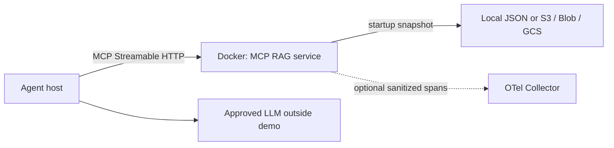

# Architecture definition and governance

Status: demo baseline, TOGAF-aligned deliverables. Formal organizational conformance
requires your architecture board's review; this repository is not a TOGAF certification
or PCI assessment. TOGAF is a governance framework, not a Python coding standard.

| ADM area | Deliverable and accountability |
|---|---|
| Preliminary / A | Scope: read-only evidence for support agents. Owners: platform engineer, data owner, security reviewer, architecture board. Principles: least privilege, contract-first, no payment data. |
| B: Business | Knowledge retrieval capability; no payment execution. Agent owner owns answer quality and human approval. |
| C: Data / Application | Code-spec interfaces; JSON corpus; stable citations; host owns model orchestration. Data owner approves every corpus revision. |
| D: Technology | Python 3.12, MCP v2, Docker, official cloud SDKs, optional OTel. No infrastructure is provisioned by this repo. |
| E / F: Opportunities / Migration | Local demo -> approved sanitized cloud corpus -> private gateway and identity integration -> performance and security acceptance -> governed rollout. |
| G: Implementation governance | CI tests, CALM schema/drift gates, image build/smoke check; deployment additionally requires security validation and change approval. |
| H: Change management | Version spec, preserve IDs, add ADRs, review API compatibility and dependency changes. |
| Requirements management | REQ-001..010 in code-spec.json connect behavior to implementation and evidence. |

## Decisions and tradeoffs

ADR-001: Immutable corpus per process; stateless requests can scale horizontally.
Roll out the same versioned object to each replica to avoid inconsistent snapshots.
ADR-002: Deterministic lexical retrieval keeps the demo credential-free and testable;
it has no semantic similarity or large-corpus indexing. Replace behind the retrieval
contract when measured recall demands embeddings, chunking or a vector store.
ADR-003: Official object-storage SDKs use ambient workload identities. Permissions
are operator-owned and limited to the configured corpus object.
ADR-004: Code-spec JSON is the architecture source; CALM is a generated projection.

## Operational baseline and gaps

One corpus is at most 1 MiB / 200 documents. Queries are at most 500 characters and
results at most 10 documents of 12,000 characters each. Readiness succeeds only after
snapshot load. Changes take effect on restart. Stop/restart is the demo rollback model;
production must retain and promote versioned images and versioned corpus objects.
The optional OTel span includes only result count. No request logging is enabled.
Full tracing, metrics, audit records, dashboard provisioning and SLOs are platform work.
Proposed target to validate: p95 warm retrieval <250 ms at 10 concurrent requests on
one CPU; this is an acceptance target, not a measured claim.

Trust boundaries: caller -> MCP runtime; runtime -> cloud identity/storage; runtime ->
collector. Local loopback is the demo access boundary. Before shared hosting add a
private TLS gateway, MCP-compatible OAuth/resource audience checks, authorized corpus
access, request-size/rate/concurrency limits and metadata-only audit events. Prompt
injection remains a host risk: retrieved content is evidence, never executable policy.
Do not load multiple tenants' data into this single shared corpus service.
